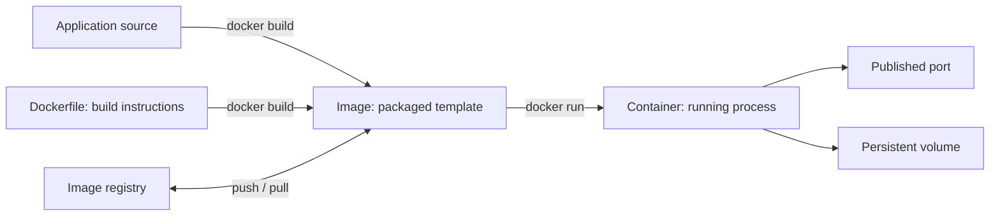

# Docker Concepts

Docker packages an application and its runtime dependencies into an image. A container is a running, isolated process created from an image. These notes introduce the core concepts and commands used in this portfolio.

## How Docker fits together



## Core concepts

### Image

An image is a read-only package containing application files, runtime dependencies, and metadata about how to start the app. Images are built in layers and can be reused to create multiple containers. A tag such as `python:3.12-slim` identifies an image version; for repeatable deployments, pin image versions and update them deliberately.

### Container

A container is an isolated process started from an image. Containers are designed to be replaceable: data that must survive container removal should live in a volume or external storage, not only in the container's writable layer.

### Dockerfile

A Dockerfile lists the steps Docker uses to build an image. Common instructions include:

| Instruction | Purpose | Example |
|---|---|---|
| `FROM` | Select a base image | `FROM python:3.12-slim` |
| `WORKDIR` | Set the working directory | `WORKDIR /app` |
| `COPY` | Copy files into the image | `COPY app.py .` |
| `RUN` | Run a build-time command | `RUN pip install -r requirements.txt` |
| `EXPOSE` | Document the port the app listens on | `EXPOSE 5000` |
| `CMD` | Set the default process | `CMD ["python", "app.py"]` |

`EXPOSE` documents a container port; it does not publish the port to your computer. Use `docker run -p` or Compose `ports` to publish it.

### Ports and networking

Containers have their own network interfaces. Publishing a port maps a host port to a container port, for example `-p 8080:80` maps host port 8080 to container port 80. In Compose, services on the same default network can reach one another by service name. A database service usually does not need a published host port if only the app container connects to it.

### Volumes

Volumes store data outside a container's writable layer. Removing or replacing a container does not remove a named volume, so volumes are useful for database files. Bind mounts map a host path into a container and are useful for local development. Removing a named volume deletes its data.

### Environment variables

Environment variables let you configure an image when it runs, without baking settings into the image. Keep local values in an ignored `.env` file, commit a `.env.example` with placeholder values, and never commit passwords, API keys, or other real secrets. For production, use an appropriate secrets manager rather than treating a plain `.env` file as secure storage.

### Registries

A registry stores and distributes images. Docker Hub and Amazon ECR are examples. You build an image locally, tag it with a registry and repository name, then push it so another machine or deployment system can pull it.

### Docker Compose

Docker Compose describes and runs an application made of multiple services. A `compose.yaml` can define images or build instructions, ports, environment variables, dependencies, health checks, networks, and volumes. Compose is useful for local development and learning multi-container applications.

## Useful commands

```bash
docker build -t my-app:dev .       # Build an image from the current directory
docker images                      # List local images
docker run --rm -p 8080:80 my-app:dev  # Run a container and publish a port
docker ps                          # List running containers
docker ps -a                       # List all containers
docker logs -f CONTAINER           # Follow container logs
docker exec -it CONTAINER sh       # Open a shell in a running container
docker stop CONTAINER              # Stop a running container
docker rm CONTAINER                # Remove a stopped container
```

Replace `CONTAINER` with a container name or ID. Add `sudo` before Docker commands only if your Linux installation requires it; membership in the Docker group grants powerful host-level access.

## Production troubleshooting guide

Start with the symptom, collect evidence, and change one thing at a time. Check the container state and recent logs before restarting it; a restart may hide useful evidence without fixing the cause.

```bash
docker ps -a
docker logs --tail 100 CONTAINER
docker inspect CONTAINER
docker stats
```

| Symptom | What to check | Common causes and next steps |
|---|---|---|
| Container exits or keeps restarting | `docker ps -a`, `docker logs CONTAINER`, and `docker inspect CONTAINER` | The app process may be exiting, configuration may be invalid, or a dependency may be unavailable. Find the first application error and fix its cause. Check the container exit code and restart policy. |
| App returns 5xx or cannot reach its database | App logs, database logs, DNS/service name, credentials, and Compose health state | Verify the app uses the Compose service name and container port, credentials match, and the database is healthy. Startup ordering alone does not guarantee the dependency is ready; use a health check and readiness handling. |
| Host cannot connect to the app | `docker port CONTAINER`, `docker inspect`, host firewall, and cloud security group | Confirm the port is published to the expected host interface and that the app listens on `0.0.0.0` inside the container. For a cloud VM, also check the host firewall and cloud network rules. |
| Port is already allocated | `docker ps`, `docker port`, and the host's listening sockets | Another process or container uses the host port. Stop or reconfigure that listener, or choose a different host port. Keep the container's application port unchanged if appropriate. |
| Container runs out of memory or is killed | `docker stats`, host memory, kernel/container runtime events, and application metrics | Look for memory leaks, too much concurrency, or oversized workloads. Tune the app and resource limits based on measurements; a limit set too low can cause OOM kills. |
| Container is slow or CPU-bound | `docker stats`, application latency metrics, logs, and dependency health | Identify whether time is spent in the app, database, disk, or network. Compare CPU and memory usage with normal baselines before scaling or changing limits. |
| Disk fills up | `df -h`, `docker system df`, log sizes, and volume usage | Find growing logs, unused images, build cache, or application data. Rotate logs and remove only resources confirmed to be unused. Do not prune volumes blindly; they may contain database data. |
| Data disappeared after redeploy | Compose volume configuration and `docker volume ls` / `docker volume inspect` | Data may have been written to the container layer, the volume may not be mounted, or the volume may have been removed. Mount a persistent volume and maintain tested backups. |
| New image deployed but old behavior remains | `docker image ls`, container image ID in `docker inspect`, and deployment logs | The container may still run the previous image, or a mutable tag/cache may have reused an old build. Use an explicit version tag or digest and ensure the deployment pulls and recreates containers with the intended image. |
| Permission denied for app files or mounted volumes | Container UID/GID, file ownership, mount options, and app logs | Ensure the non-root container user can read or write only the required paths. Set ownership or permissions narrowly; avoid broad `chmod 777` fixes. |
| Health check reports unhealthy | `docker inspect` health status and health-check command output | Confirm the check exists in the image, uses installed tools, targets the correct local endpoint, and has realistic timeout/start-period/retry values. A health check reports status; it does not automatically repair the app. |

### Safe incident workflow

1. Record when the issue started, its user impact, and the most recent deployment or configuration change.
2. Check container state, logs, resource use, health checks, and dependency state.
3. Compare the failing service with a known-good instance or release where possible.
4. Make one reversible change and observe whether the symptom changes.
5. If rollback is needed, redeploy a known-good image version and preserve logs and data for investigation.
6. After recovery, identify the root cause and add monitoring, a runbook step, or an automated safeguard.

Avoid putting secrets in command-line arguments or logs. Redact credentials and personal data before sharing diagnostic output.

## Scenario-based Docker interview questions

Try answering each question before reading the guidance.

### 1. A container starts and exits immediately. How would you investigate?

**Answer guide:** Check `docker ps -a`, the exit code, and `docker logs`. Inspect the configured command and environment with `docker inspect`. Confirm the app runs as the foreground process and that configuration and required dependencies are available. Fix the underlying error instead of adding a restart loop as a substitute for diagnosis.

### 2. Your app container cannot connect to PostgreSQL in Compose. What do you check?

**Answer guide:** Check both services' logs and health status. Confirm the app connects to the Compose service name (for example, `db`) and the database container port, not `localhost` or a host-published port. Verify credentials and database name, then ensure the app waits for database readiness and retries transient connection failures.

### 3. A container works locally but is unreachable on a server. What could explain it?

**Answer guide:** Check the published host-to-container port mapping, the address the application binds to inside the container, host firewall rules, and cloud security-group/network rules. A process bound only to `127.0.0.1` inside the container may not accept forwarded traffic; it usually needs to bind to `0.0.0.0`.

### 4. The database loses data when you deploy a new container. How do you prevent this?

**Answer guide:** Persist database files in a named volume or managed database, verify the mount path matches the database's data directory, and avoid deleting the volume during routine deploys. Backups are still necessary: a volume protects against container replacement, not accidental deletion or data corruption.

### 5. A deployment uses the `latest` tag and unexpectedly runs old code. What is your fix?

**Answer guide:** Build and deploy immutable, versioned image tags (or digests), confirm the deployment pulls the intended artifact, and recreate the container. A mutable tag such as `latest` can point to different image contents over time and makes rollback ambiguous.

### 6. A container was killed during a traffic spike. What evidence do you gather?

**Answer guide:** Review container state and events, memory and CPU metrics, host memory pressure, and application-level concurrency and latency. Determine whether the process was OOM-killed and whether a configured memory limit was reached. Tune the workload, app, and resource limits using observed data.

### 7. The server disk is full, and Docker is using a lot of space. What do you do?

**Answer guide:** Use `df -h` and `docker system df`, then identify whether images, build cache, logs, or volumes are responsible. Clean up only confirmed-unused resources, rotate or cap logs, and preserve volumes until their contents are verified and backed up. Avoid a blind `docker system prune --volumes`.

### 8. A container is reported unhealthy, but the application seems to work. How do you debug it?

**Answer guide:** Inspect the health status and recorded check output. Run the check command in the container, confirm its tools and endpoint are available, and review start period, timeout, and retry settings. Make the check measure a meaningful readiness condition; health status alone does not restart or repair a failing process.

### 9. Why run an application as a non-root user in its container?

**Answer guide:** It limits the process's permissions inside the container if the app is compromised. Verify required files and writable directories are accessible to that user. Container isolation is useful but does not replace host security, patching, or least-privilege controls.

### 10. How would you roll back a broken container release?

**Answer guide:** Keep the previous known-good image artifact and deployment configuration. Re-deploy that exact version, verify health and user-facing behavior, and preserve logs from the failed release. Consider database schema compatibility before rolling back app code, and follow up with a root-cause fix.

## Security and good habits

- Use a small, maintained base image and update it deliberately.
- Run the application as a non-root user when possible.
- Keep secrets out of Dockerfiles, image layers, and Git.
- Publish only the ports that need to be reachable.
- Use volumes for persistent data and back up important data.
- Use `.dockerignore` to keep irrelevant files and local secrets out of the build context.
- Prefer exec-form commands such as `CMD ["python", "app.py"]` so the application receives operating-system signals correctly.

## Portfolio example

The [Dockerized Web App with PostgreSQL](../Projects/dockerized-web-app/README.md) project applies these concepts: its Dockerfile builds the Flask image, Compose runs the app and database services, environment variables configure both, and a named volume stores PostgreSQL data.
