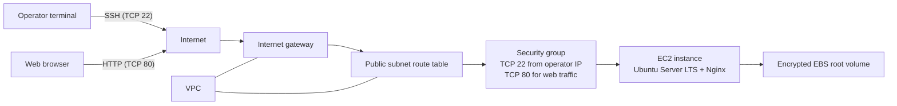

# Ubuntu EC2 App Server

This project documents an Ubuntu web server running Nginx on Amazon EC2. It covers the architecture, setup through the AWS Management Console, basic validation, and teardown.

## Architecture

The setup uses one internet-facing EC2 instance in a public subnet. HTTP traffic reaches Nginx on TCP port 80. SSH is limited to the operator's current public IP. The instance uses an EBS root volume for persistent storage.



The VPC and subnet can be existing resources or created as part of the launch workflow. For direct SSH, the subnet route table needs a default route to an internet gateway, and the instance needs a public IPv4 address. This is a basic single-instance setup, not a highly available or production-hardened design.

## Setup

### Prerequisites

- Sign in to the [AWS Management Console](https://console.aws.amazon.com/) with permission to use Amazon EC2.
- Choose the AWS Region where you want the instance. EC2 resources are regional.
- Decide on an instance size and review its price in the launch wizard. Free Tier eligibility depends on your account, Region, instance type, and current AWS terms; do not assume an instance is free.
- Have an SSH client available on your computer.

### Launch the instance

1. Open **EC2** in the Console, select the correct Region, and choose **Instances** → **Launch instances**.
2. Under **Name and tags**, enter a name, such as `ubuntu-app-server`.
3. Under **Application and OS Images (Amazon Machine Image)**, select **Ubuntu** and choose an Ubuntu Server LTS AMI published by Canonical. Check the AMI details and architecture before continuing.
4. Under **Instance type**, choose a type that fits your workload and budget. Make sure its architecture is compatible with the selected AMI.
5. Under **Key pair (login)**:
   - Choose an existing key pair, or choose **Create new key pair**.
   - If creating one, select a name and a supported key type, then download the private key file. AWS will not let you download that private key again. Store it securely and never share or commit it.
6. Under **Network settings**, choose a VPC and subnet. For direct SSH from your computer, the instance needs a public IPv4 address and a route to an Internet gateway.
7. Configure the security group:
   - Allow **SSH** on TCP port **22** from **My IP** only.
   - Do not expose SSH to `0.0.0.0/0` or `::/0`. If your public IP changes, update the rule to your current IP.
   - To make the demo web page publicly reachable, allow **HTTP** on TCP port **80** from `0.0.0.0/0`. If the instance uses IPv6 and should be reachable over IPv6, also allow port 80 from `::/0`. These rules make the web server public; do not serve sensitive content over plain HTTP.
8. Under **Configure storage**, select an appropriate EBS volume size and ensure **Delete on termination** is enabled if you want the root volume removed when you terminate the instance. Enable EBS encryption if it is not already enabled.
9. In **Advanced details**, set **Metadata version** to **V2 only (token required)** if that setting is available.
10. Review the summary, then choose **Launch instance**.
11. Choose **View all instances** and wait until the instance is **Running**.

### Connect over SSH

1. In **EC2** → **Instances**, select your instance and copy its **Public IPv4 address**.
2. On your computer, open a terminal and restrict access to the downloaded private key:

   ```bash
   chmod 400 /path/to/your-key.pem
   ```

3. Connect using the Ubuntu default username:

   ```bash
   ssh -i /path/to/your-key.pem ubuntu@PUBLIC_IPV4_ADDRESS
   ```

   Replace the key path and `PUBLIC_IPV4_ADDRESS` with your own values. Confirm the host fingerprint when prompted if you expect to connect to this instance.

### Install and start Nginx

After connecting to the instance over SSH, install Nginx and enable its service:

```bash
sudo apt update
sudo apt install -y nginx
sudo systemctl enable --now nginx
```

The `enable` option starts Nginx automatically when the instance boots again; `--now` starts it immediately. To check the service:

```bash
sudo systemctl status nginx --no-pager
```

Press `q` to exit the status view if needed.

## Checks

Confirm the instance is ready before using it:

1. In **EC2** → **Instances**, confirm the instance state is **Running** and both **System status checks** and **Instance status checks** pass.
2. Connect using the SSH instructions above.
3. On the instance, run these checks to confirm the OS and available root disk:

   ```bash
   lsb_release -a
   df -h /
   ```

4. Confirm Nginx is active and returns a local HTTP response:

   ```bash
   sudo systemctl is-active nginx
   curl -I http://localhost
   ```

   The service check should print `active`, and the HTTP response should have a successful status such as `200 OK`.
5. From your computer, open `http://PUBLIC_IPV4_ADDRESS` in a browser, replacing the address with the instance's public IPv4 address. The default Nginx welcome page should appear.
6. To customize the default page, edit `/var/www/html/index.nginx-debian.html` on the instance, then refresh the browser.

If SSH times out, check that the instance has a public IPv4 address, its subnet route table has a route to an internet gateway, and the security group's SSH rule allows your current public IP. If SSH reports **Connection refused**, wait for boot to finish and recheck the status checks. If authentication fails, verify the key path and use the `ubuntu` username.

If the browser cannot reach Nginx, confirm you used `http://` (not `https://`), the security group allows inbound TCP port 80 from your client, the instance has a public IPv4 address and internet-gateway route, and `sudo systemctl is-active nginx` reports `active`. HTTPS requires additional TLS configuration and is not set up by these steps.

## Teardown

1. Back up any files or application data you need to keep. Terminating an instance is permanent.
2. In **EC2** → **Instances**, select the instance and choose **Instance state** → **Terminate instance**. Confirm the termination.
3. After termination, check **EC2** → **Volumes** for any EBS volumes that remain. Delete only volumes you no longer need and have confirmed are not attached to another resource.
4. Check **Snapshots** and **Elastic IPs** for resources created for this project that you no longer need. Snapshots and allocated public IPv4 addresses can continue to incur charges; release or delete them only after confirming they are no longer required.
5. If the security group, key pair, or VPC resources were created only for this project, remove them when they are no longer in use. A key pair in EC2 does not incur a charge, but retain or securely dispose of its local private key according to your needs.

Stopping an instance is an alternative if you intend to use it again: compute billing stops, but EBS storage and some other resources can still incur charges, and the automatically assigned public IPv4 address may change when it starts again. Check current EC2 and public IPv4 pricing for your Region before leaving resources running.